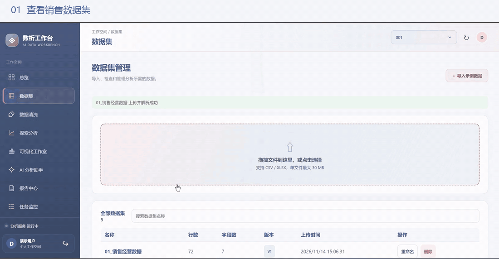
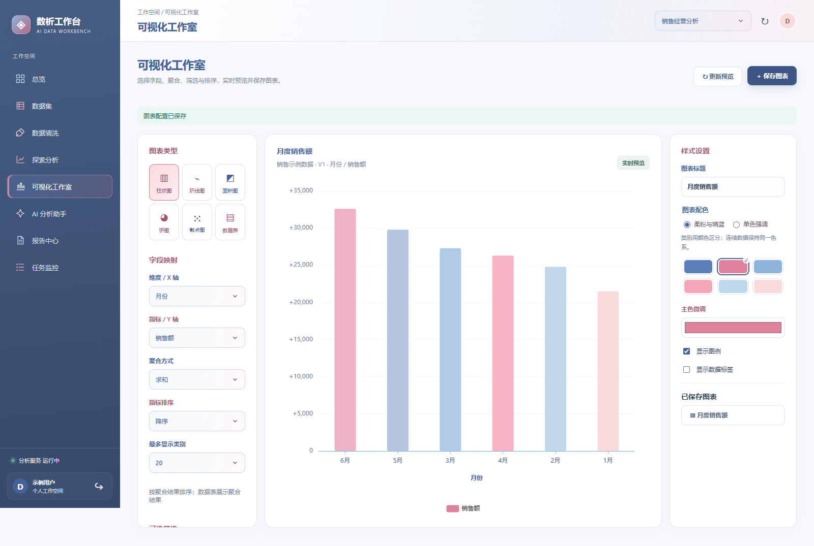
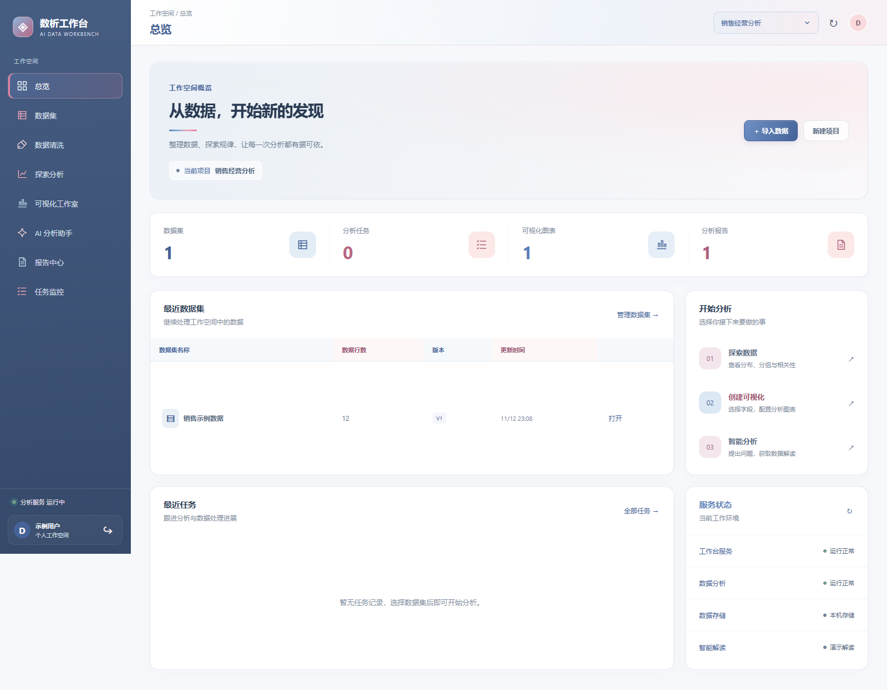
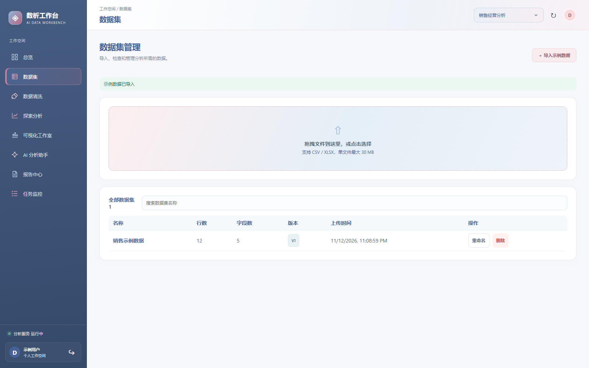
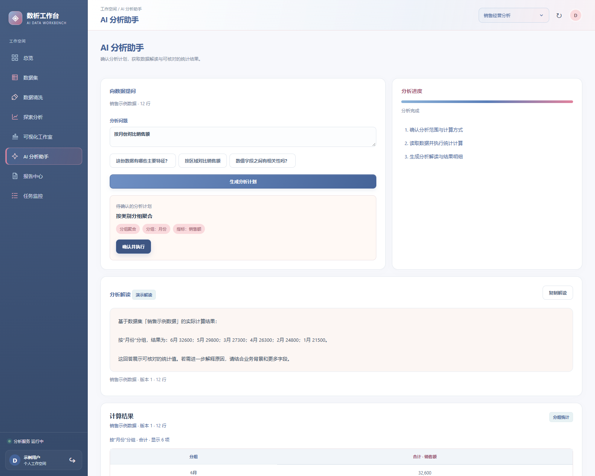
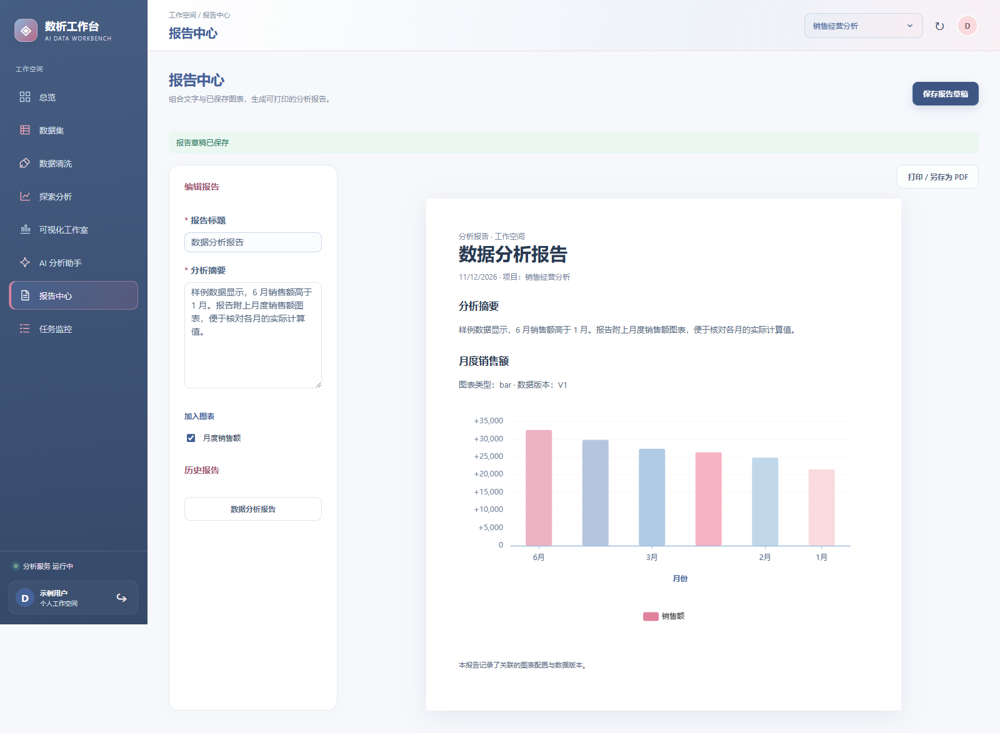
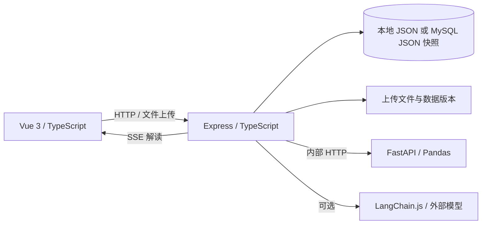

# 数析 · AI 数据分析与可视化工作台

上传数据、清洗、计算、绘图和编写报告，都在同一个工作台内完成。前端负责数据预览与图表交互；Node.js 服务处理账号、项目和业务接口；Python 服务执行统计计算。AI 助手先给出分析计划，用户确认后才运行计算。

> 支持本地运行。统计服务完成数据清洗与计算，AI 助手基于计算结果生成流式解读；未配置模型服务时，可使用演示模式体验流程。

[功能](#功能) · [架构](#架构) · [工程实现](#工程实现) · [技术栈](#技术栈) · [本地运行](#本地运行) · [验证](#验证)

[](https://github.com/tao706/ai-data-workbench-open-source/actions/workflows/ci.yml)

## 实际操作

下面的约 40 秒预览展示五步流程：导入数据集 → 数据清洗 → 可视化工作室 → AI 分析助手 → 生成报告。包含点击示例问题、生成并确认计划和查看解读的过程；顶部步骤提示用于衔接节选，保留片段按原速播放。

[](https://github.com/tao706/ai-data-workbench-open-source/blob/main/docs/videos/workflow-preview.mp4)

**[观看五步流程（40 秒，MP4，约 1.3 MB）](https://github.com/tao706/ai-data-workbench-open-source/blob/main/docs/videos/workflow-preview.mp4)** · [下载五步流程视频](https://raw.githubusercontent.com/tao706/ai-data-workbench-open-source/main/docs/videos/workflow-preview.mp4)

**[查看完整演示（86 秒，原速 MP4，约 1.8 MB）](https://github.com/tao706/ai-data-workbench-open-source/blob/main/docs/videos/workflow-full.mp4)** · [直接下载视频](https://raw.githubusercontent.com/tao706/ai-data-workbench-open-source/main/docs/videos/workflow-full.mp4)

完整演示包含数据集管理、数据清洗、探索分析、图表配置、AI 分析和报告保存，使用虚构销售数据及已配置的模型服务。点击预览图可打开完整视频；若浏览器未提供播放入口，可下载后观看。

[按步骤体验](docs/DEMO.md) · [部署说明](docs/DEPLOY.md) · [下载 v0.1.0](https://github.com/tao706/ai-data-workbench-open-source/releases/tag/v0.1.0)

### 可视化工作室

按月份汇总销售额，设置图表标题、配色并保存配置。



<details>
<summary>更多界面：总览、数据集、AI 分析与报告</summary>









</details>

录制中的数据、账号和项目均为示例，不代表业务收益或性能测试结果。

## 功能

| 模块 | 当前实现 |
| --- | --- |
| 账号与项目 | 注册、登录、个人项目切换；项目下的数据按归属隔离 |
| 数据集 | 上传 CSV / XLSX、导入销售示例、字段画像、数据预览、版本记录与恢复 |
| 数据清洗 | 对选定数据集组合缺失值、重复值、类型转换和 IQR 异常值规则，保存新版本 |
| 探索分析 | 描述统计、分组聚合、相关性计算，展示可核对的结果表格 |
| 可视化工作室 | 柱状图、折线图、面积图、饼图、散点图和数据表；配置字段、聚合、筛选与排序，保存图表 |
| AI 分析助手 | 根据问题生成分析计划，确认后执行计算；可选模型流式解读，并展示计算依据 |
| 报告中心 | 组合文字与已保存图表，保存草稿，通过浏览器打印为 PDF |
| 任务监控 | 查看任务和服务状态，删除已结束的任务记录 |

从“数据集”导入示例数据后，可按 **数据清洗 → 探索分析 → 可视化工作室 → AI 分析助手 → 报告中心** 的顺序体验完整流程。

## 示例数据

[examples/](examples/) 提供三组程序生成的虚构数据，每组都有 CSV 和 XLSX，选择一种格式导入即可。操作与核对点见[使用说明](examples/使用说明.md)。

| 数据 | 内容 | 推荐体验 |
| --- | --- | --- |
| [销售经营](examples/01_销售经营数据.xlsx) | 72 行，销售额合计 1,435,680 元 | 按区域汇总、月度趋势、订单数与销售额散点图 |
| [网站运营](examples/02_网站运营数据.xlsx) | 90 行，包含渠道、访问与转化指标 | 渠道对比、日期趋势、筛选和相关性分析 |
| [设备监测](examples/03_设备监测_清洗练习.xlsx) | 50 行，含重复行、缺失值和异常值 | 去重、填充缺失值、异常值处理及版本对比 |

先创建或选择项目，在“数据集”中上传文件。建议从销售经营数据开始；设备数据去重后应为 48 行。以上文件用于功能体验，不代表真实业务数据。

## 架构



Express 管理用户、项目、数据集、图表、报告和任务；FastAPI 负责文件解析与确定性计算。图表由前端根据计算结果渲染，AI 回答不能替代原始结果表。

## 工程实现

### 切换项目后，页面不能继续显示上一项目的数据

之前项目名称已经切换，首页统计和任务仍显示旧数据。只更新下拉框的选中值不够：接口查询范围、共享状态和页面内的临时状态都要一起切换，先发出的慢请求也可能晚于新请求返回。

现在首页请求携带 `projectId`，后端校验项目归属并按项目统计；Pinia 在项目变化时同步清空已选数据集和图表草稿中的字段。页面以项目 ID 和路由作为组件 key，重建当前页面的临时状态。首页接收响应前再次比较项目 ID，丢弃属于旧项目的结果。

- 实现：[工作区状态](frontend/src/store.ts)、[页面切换](frontend/src/App.vue)、[首页请求](frontend/src/pages/Overview.vue)、[统计接口](backend/src/server.ts)。
- 验证：[浏览器回归测试](e2e/project-switch.spec.ts)模拟甲项目请求延迟返回，确认切到乙项目后统计不被覆盖，数据集、任务和 AI 助手不残留甲项目内容；[接口测试](backend/tests/project-scope.test.js)检查统计范围与项目归属。

### 图表与数据表来回切换，预览仍能重新绘制

可视化工作室切到数据表或空结果时，图表容器会被条件渲染移除。若只在首次挂载时初始化 ECharts，再切回图表就可能留下空白，旧实例也可能继续绑定已移除的容器。

`ChartView` 在 DOM 更新后监听容器引用：先断开旧的尺寸监听并销毁实例，再为新容器初始化。容器尺寸变化时通过 `ResizeObserver` 调整图表；组件卸载时清理监听和实例。切换图表类型时完整替换配置，避免上一种图表的坐标轴、图例或系列配置残留。预览请求另带递增序号，只有最新请求可以更新数据、错误和加载状态。

- 实现：[图表组件](frontend/src/components/ChartView.vue)、[预览请求与字段校验](frontend/src/pages/Studio.vue)。横轴标签根据容器宽度采样，密集时旋转并隐藏重叠标签，悬浮提示保留完整数值。
- 验证：[操作录屏](docs/images/workflow-demo.gif)展示多种图表切换与样式配置；[主流程测试](e2e/workflow.spec.ts)覆盖图表保存。当前尚无专门断言图表实例销毁和尺寸变化的自动化测试。

### 请求失败后，用户能看到原因并继续操作

任务删除曾出现确认后没有明显反馈的问题。现在删除请求未成功时，确认弹窗保持打开，在弹窗内显示错误，用户可以直接重试；成功后再关闭弹窗并移除列表记录。

普通请求统一区分超时、网络不可用和服务端错误。AI 解读通过 SSE 接收进度和文本，解析时保留未收齐的事件片段；连接结束却没有完成或错误事件时，提示结果可能不完整。用户停止或离开页面时取消流式请求，取消操作与请求失败分别显示。

- 实现：[删除交互](frontend/src/pages/Tasks.vue)、[请求封装与 SSE 解析](frontend/src/api.ts)、[AI 助手状态](frontend/src/pages/Assistant.vue)。
- 验证：[删除重试测试](e2e/task-delete.spec.ts)让首次删除返回 503，检查错误留在弹窗内，第二次成功后关闭并移除记录；[模型流测试](backend/tests/ai-service.test.js)用模拟接口检查计算结果传入模型及文本分片返回。该模型测试不代表已覆盖浏览器断网、取消和所有分包情况。

其余实现包括虚拟滚动数据预览、图表绑定数据版本，以及 HttpOnly Cookie 会话和接口资源归属校验。运行与验证方式见下文。

## 技术栈

| 层次 | 技术 | 用途 |
| --- | --- | --- |
| 前端 | Vue 3、TypeScript、Vite、Vue Router、Pinia、Element Plus、CSS | 页面、路由、状态与交互 |
| 图表 | ECharts | 图表预览与展示 |
| 业务服务 | Node.js、Express、TypeScript、Zod、Multer | 业务接口、输入校验、文件上传与 SSE |
| 数据计算 | Python、FastAPI、Pandas | 文件解析、清洗和统计分析 |
| 数据存储 | 本地 JSON；可选 MySQL | 项目状态、数据文件与版本记录 |
| 模型接入 | LangChain.js、兼容 Chat Completions 的模型接口 | 对统计结果生成可选的流式解读 |
| 验证 | TypeScript 构建、Node 测试、Python 测试、Playwright | 类型、接口、计算与主流程检查 |

## 本地运行

需要 Node.js 20+、Python 3.10+。以下命令在 Windows PowerShell 中执行，三个服务分别占用一个终端。

在项目根目录准备配置：

```powershell
Copy-Item .env.example .env
```

终端一，启动分析服务：

```powershell
cd analysis-service
python -m venv .venv
.\.venv\Scripts\python.exe -m pip install -r requirements.txt
.\.venv\Scripts\python.exe -m uvicorn app:app --host 127.0.0.1 --port 8100
```

终端二，启动业务服务：

```powershell
cd backend
npm install
npm run build
npm run start
```

终端三，启动前端：

```powershell
cd frontend
npm install
npm run dev
```

打开 `http://127.0.0.1:5173`。可注册账号，或使用本地演示账号 `demo@example.com` / `Demo123456!`。初次进入后新建项目，再导入示例数据。

不配置 MySQL 时，状态保存在 `backend/data/state.json`。配置 `MYSQL_URL` 后，状态写入 MySQL 的 `app_state` JSON 字段；[schema.sql](database/schema.sql) 是后续拆分业务表的设计稿，当前运行代码并未逐表使用。模型接口需在 `.env` 配置 `OPENAI_API_KEY`，并按服务商填写 `OPENAI_BASE_URL` 和 `OPENAI_MODEL`；无密钥也可体验计算和演示解读。

## 验证

安装依赖后，在项目根目录运行：

```powershell
npm run build
npm test
cd analysis-service
.\.venv\Scripts\python.exe -m unittest test_app
```

三个服务启动后，可在项目根目录运行 `npm run test:e2e` 检查浏览器主流程。业务服务健康检查地址为 `http://127.0.0.1:3100/api/health`，分析服务接口文档为 `http://127.0.0.1:8100/docs`。

## 目录

```text
frontend/          页面、组件、状态、接口调用与图表
backend/           认证、业务接口、任务、存储与模型接入
analysis-service/  文件解析、数据清洗与统计计算
database/          MySQL 业务表设计
e2e/               浏览器主流程测试
docs/              架构和交付说明
```

## 当前限制

- 目前主要面向本地单机演示。分析任务同步执行，没有持久化任务队列与崩溃恢复。
- MySQL 当前保存整份 JSON 状态，尚未使用独立业务表；不适合直接承载高并发多用户场景。
- 报告 PDF 依赖浏览器打印，没有独立的服务端 PDF 渲染。
- 模型解读以统计结果为依据，业务原因和行动建议仍需结合实际背景判断。
- 生产启动已校验会话密钥和 HTTPS 来源、关闭默认演示账号，并对登录注册限流；备份恢复、容量和安全测试仍需在目标环境完成。

单机容器部署配置及上线前的验证事项见 [部署说明](docs/DEPLOY.md)。上传的数据文件、状态文件和 `.env` 属于本地运行数据，不应提交到公开仓库。

## 许可

自有代码采用 [MIT](LICENSE)。第三方依赖遵循各自许可证。

版本变更见 [CHANGELOG](CHANGELOG.md)，本地验证范围见 [验证记录](docs/VERIFICATION.md)。
