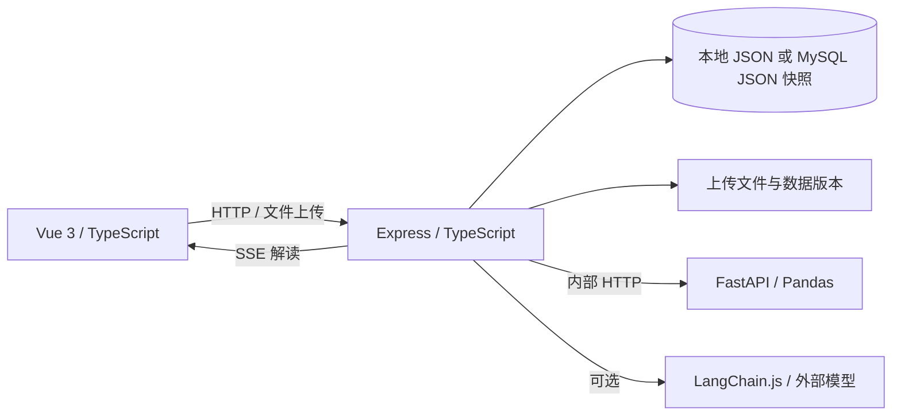

# 数析 · AI 数据分析与可视化工作台

上传数据、清洗、计算、绘图和编写报告，都在同一个工作台内完成。前端负责数据预览与图表交互；Node.js 服务处理账号、项目和业务接口；Python 服务执行统计计算。AI 助手先给出分析计划，用户确认后才运行计算。

> 这是本地运行的工程作品。数据计算由程序完成，模型仅负责解释计算结果；未配置模型密钥时使用演示解读。当前不包含文档检索 RAG，也未按公网多用户服务验收。

[功能](#功能) · [架构](#架构) · [工程实现](#工程实现) · [技术栈](#技术栈) · [本地运行](#本地运行) · [验证](#验证)

[](https://github.com/tao706/ai-data-workbench-open-source/actions/workflows/ci.yml)

## 实际操作

注册账号、导入销售示例、保存月度销售额图表、确认分析计划，再把图表加入报告。下面录制来自本地应用的实际操作，使用项目自带的 12 行销售数据。AI 部分使用演示解读。


[查看原始录屏](docs/videos/workflow.webm) · [按步骤体验](docs/DEMO.md) · [部署说明](docs/DEPLOY.md)

### 可视化工作室

按月份汇总销售额，设置图表标题、配色并保存配置。


<details>
<summary>更多界面：总览、数据集、AI 分析与报告</summary>


</details>

录制中的数据、账号和项目均为示例，不代表业务收益或性能测试结果。

## 功能

| 模块 | 当前实现 |
| --- | --- |
| 账号与项目 | 注册、登录、个人项目切换；项目下的数据按归属隔离 |
| 数据集 | 上传 CSV / XLSX、导入销售示例、字段画像、数据预览、版本记录与恢复 |
| 数据清洗 | 对选定数据集组合缺失值、重复值、类型转换和 IQR 异常值规则，保存新版本 |
| 探索分析 | 描述统计、分组聚合、相关性计算，展示可核对的结果表格 |
| 可视化工作室 | 柱状图、折线图、面积图、饼图、散点图和数据表；配置字段、聚合、筛选与排序，保存图表 |
| AI 分析助手 | 根据问题生成分析计划，确认后执行计算；可选模型流式解读，并展示计算依据 |
| 报告中心 | 组合文字与已保存图表，保存草稿，通过浏览器打印为 PDF |
| 任务监控 | 查看任务和服务状态，删除已结束的任务记录 |

从“数据集”导入示例数据后，可按 **数据清洗 → 探索分析 → 可视化工作室 → AI 分析助手 → 报告中心** 的顺序体验完整流程。

## 架构



Express 管理用户、项目、数据集、图表、报告和任务；FastAPI 负责文件解析与确定性计算。图表由前端根据计算结果渲染，AI 回答不能替代原始结果表。

## 工程实现

| 关注点 | 实现方式 |
| --- | --- |
| 前端状态 | Pinia 管理工作区状态；Vue Router 组织页面；Element Plus 承担表格、分页和对话框等交互 |
| 大表预览 | 虚拟滚动减少预览时的 DOM 数量，支持字段搜索与别名 |
| 版本追溯 | 清洗生成新数据版本；已保存图表记录所用版本，重新打开时按该版本计算 |
| 计算边界 | AI 助手先给出有限类型的分析计划，用户确认后再调用统计接口；页面显示计算结果供核对 |
| 流式反馈 | 服务端通过 SSE 发送解读进度与文本，前端按事件更新状态 |
| 认证与隔离 | 密码使用加盐 scrypt 哈希；会话写入 HttpOnly Cookie；接口按项目归属校验资源 |
| 异常处理 | 上传限制、字段与规则校验、服务错误提示，以及任务失败状态 |

## 技术栈

| 层次 | 技术 | 用途 |
| --- | --- | --- |
| 前端 | Vue 3、TypeScript、Vite、Vue Router、Pinia、Element Plus、CSS | 页面、路由、状态与交互 |
| 图表 | ECharts | 图表预览与展示 |
| 业务服务 | Node.js、Express、TypeScript、Zod、Multer | 业务接口、输入校验、文件上传与 SSE |
| 数据计算 | Python、FastAPI、Pandas | 文件解析、清洗和统计分析 |
| 数据存储 | 本地 JSON；可选 MySQL | 项目状态、数据文件与版本记录 |
| 模型接入 | LangChain.js、兼容 Chat Completions 的模型接口 | 对统计结果生成可选的流式解读 |
| 验证 | TypeScript 构建、Node 测试、Python 测试、Playwright | 类型、接口、计算与主流程检查 |

## 本地运行

需要 Node.js 20+、Python 3.10+。以下命令在 Windows PowerShell 中执行，三个服务分别占用一个终端。

在项目根目录准备配置：

```powershell
Copy-Item .env.example .env
```

终端一，启动分析服务：

```powershell
cd analysis-service
python -m venv .venv
.\.venv\Scripts\python.exe -m pip install -r requirements.txt
.\.venv\Scripts\python.exe -m uvicorn app:app --host 127.0.0.1 --port 8100
```

终端二，启动业务服务：

```powershell
cd backend
npm install
npm run build
npm run start
```

终端三，启动前端：

```powershell
cd frontend
npm install
npm run dev
```

打开 `http://127.0.0.1:5173`。可注册账号，或使用本地演示账号 `demo@example.com` / `Demo123456!`。初次进入后新建项目，再导入示例数据。

不配置 MySQL 时，状态保存在 `backend/data/state.json`。配置 `MYSQL_URL` 后，状态写入 MySQL 的 `app_state` JSON 字段；[schema.sql](database/schema.sql) 是后续拆分业务表的设计稿，当前运行代码并未逐表使用。模型接口需在 `.env` 配置 `OPENAI_API_KEY`，并按服务商填写 `OPENAI_BASE_URL` 和 `OPENAI_MODEL`；无密钥也可体验计算和演示解读。

## 验证

安装依赖后，在项目根目录运行：

```powershell
npm run build
npm test
cd analysis-service
.\.venv\Scripts\python.exe -m unittest test_app
```

三个服务启动后，可在项目根目录运行 `npm run test:e2e` 检查浏览器主流程。业务服务健康检查地址为 `http://127.0.0.1:3100/api/health`，分析服务接口文档为 `http://127.0.0.1:8100/docs`。

## 目录

```text
frontend/          页面、组件、状态、接口调用与图表
backend/           认证、业务接口、任务、存储与模型接入
analysis-service/  文件解析、数据清洗与统计计算
database/          MySQL 业务表设计
e2e/               浏览器主流程测试
docs/              架构和交付说明
```

## 当前限制

- 目前主要面向本地单机演示。分析任务同步执行，没有持久化任务队列与崩溃恢复。
- MySQL 当前保存整份 JSON 状态，尚未使用独立业务表；不适合直接承载高并发多用户场景。
- 报告 PDF 依赖浏览器打印，没有独立的服务端 PDF 渲染。
- 模型解读基于已计算的统计结果，不做 RAG 检索；没有模型密钥时明确使用演示解读。
- 生产启动已校验会话密钥和 HTTPS 来源、关闭默认演示账号，并对登录注册限流；备份恢复、容量和安全测试仍需在目标环境完成。

单机容器部署配置见 [部署说明](docs/DEPLOY.md)，容器启动尚待 Docker 环境验收。上传的数据文件、状态文件和 `.env` 属于本地运行数据，不应提交到公开仓库。

## 许可

自有代码采用 [MIT](LICENSE)。第三方依赖遵循各自许可证。

版本变更见 [CHANGELOG](CHANGELOG.md)，本地验证范围见 [验证记录](docs/VERIFICATION.md)。
